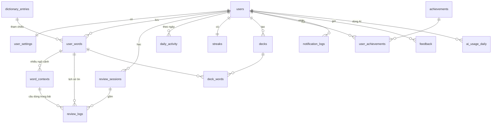

# Transaver Word: Thiết kế database

> Thiết kế database cho backend, dựa trên [feature-list.md](feature-list.md) và [product-plan.md](product-plan.md).
>
> Ngày soạn: 08/11/2026

---

## Mục lục

1. [Giả định và nguyên tắc](#1-giả-định-và-nguyên-tắc)
2. [Sơ đồ quan hệ](#2-sơ-đồ-quan-hệ)
3. [Nhóm bảng theo giai đoạn](#3-nhóm-bảng-theo-giai-đoạn)
4. [Chi tiết các bảng](#4-chi-tiết-các-bảng)
5. [Đồng bộ offline và xử lý xung đột](#5-đồng-bộ-offline-và-xử-lý-xung-đột)
6. [Các truy vấn quan trọng](#6-các-truy-vấn-quan-trọng)
7. [Xóa tài khoản](#7-xóa-tài-khoản)
8. [Những việc còn mở](#8-những-việc-còn-mở)

---

## 1. Giả định và nguyên tắc

### Giả định

| Vấn đề | Giả định trong bản thiết kế này |
|---|---|
| Hệ quản trị | **MySQL 8** (Laravel). Cần kiểu `JSON` và index trên cột sinh ra (generated column) |
| Ngôn ngữ | MVP có thể chỉ mở tiếng Anh, nhưng **schema lưu sẵn `source_lang` / `target_lang`** để sau này mở thêm ngôn ngữ mà không phải sửa bảng |
| FSRS | Server **lưu trạng thái FSRS** của từng từ và **toàn bộ lịch sử ôn**. Tính ở client hay server đều dùng được schema này (xem [mục 8](#8-những-việc-còn-mở)) |
| Đăng nhập | Google OAuth. Token API dùng Laravel Sanctum (bảng `personal_access_tokens` có sẵn của Laravel, không liệt kê lại ở đây) |

### Nguyên tắc

1. **Khóa chính `id` (BIGINT) + cột `uuid` do client sinh.** Extension tạo bản ghi khi offline hoặc chưa đăng nhập nên cần một mã duy nhất từ phía client. `uuid` cũng giúp gửi lại request mà không bị tạo trùng.
2. **Bảng nào đồng bộ với client đều có `updated_at` và `deleted_at`.** Xóa là xóa mềm, để thiết bị khác biết bản ghi đã bị xóa khi đồng bộ.
3. **`review_logs` chỉ thêm, không bao giờ sửa hay xóa.** Đây là nguồn dữ liệu gốc. Trạng thái FSRS trong `user_words` chỉ là kết quả tính ra từ lịch sử này, nên luôn tính lại được.
4. **Ngày học tính theo múi giờ của người dùng**, không theo giờ server. Streak, mục tiêu ngày và giờ nhắc đều phụ thuộc vào việc này.
5. **Tách dữ liệu dùng chung khỏi dữ liệu của từng người.** Từ điển và cache dịch dùng chung cho mọi user. Từ đã lưu, ngữ cảnh và lịch sử ôn là của riêng từng user.

---

## 2. Sơ đồ quan hệ



Luồng chính: **`users` → `user_words` (một từ) → `word_contexts` (nhiều câu đã gặp) → `review_logs` (mỗi lần ôn).**

---

## 3. Nhóm bảng theo giai đoạn

| Nhóm | Bảng | Giai đoạn |
|---|---|---|
| Tài khoản | `users`, `user_settings` | 🔴 MVP |
| Từ vựng | `dictionary_entries`, `user_words`, `word_contexts` | 🔴 MVP |
| Ôn tập | `review_logs`, `review_sessions` | 🔴 MVP |
| Động lực, thống kê | `daily_activity`, `streaks` | 🔴 MVP |
| Nhắc học | `notification_logs` | 🔴 MVP |
| Dịch, AI | `translation_cache`, `context_meaning_cache`, `ai_usage_daily` | 🔴 MVP |
| Đo lường, góp ý | `events`, `feedback` | 🔴 MVP |
| Bộ từ | `decks`, `deck_words`, `tags`, `user_word_tags` | 🟡 Giai đoạn 2 |
| Huy hiệu | `achievements`, `user_achievements` | 🟡 Giai đoạn 2 |

Bảng giai đoạn 2 chưa cần tạo ngay, nhưng cấu trúc các bảng MVP đã chừa sẵn chỗ để thêm vào sau mà không phải sửa.

---

## 4. Chi tiết các bảng

Quy ước: mọi bảng có `id BIGINT UNSIGNED AUTO_INCREMENT` làm khóa chính (trừ khi ghi khác). `created_at`, `updated_at` là `TIMESTAMP` theo UTC.

### 4.1. `users`

| Cột | Kiểu | Ghi chú |
|---|---|---|
| `uuid` | CHAR(36) UNIQUE | |
| `email` | VARCHAR(255) UNIQUE | |
| `name` | VARCHAR(255) | |
| `avatar_url` | VARCHAR(500) NULL | |
| `google_id` | VARCHAR(64) UNIQUE NULL | NULL nếu sau này đăng nhập bằng email |
| `timezone` | VARCHAR(64) | Ví dụ `Asia/Ho_Chi_Minh`. **Bắt buộc**, lấy từ trình duyệt khi đăng ký |
| `ui_locale` | VARCHAR(10) | `vi`, `en` |
| `onboarded_at` | TIMESTAMP NULL | NULL = chưa làm onboarding |
| `last_active_at` | TIMESTAMP NULL | |
| `status` | ENUM('active','banned') | |
| `created_at`, `updated_at` | | |

### 4.2. `user_settings`

Một user một dòng. Cài đặt lưu dạng JSON để thêm cài đặt mới không phải sửa bảng.

| Cột | Kiểu | Ghi chú |
|---|---|---|
| `user_id` | BIGINT PK, FK → `users` | |
| `settings` | JSON | Xem ví dụ bên dưới |
| `schema_version` | SMALLINT | Tăng lên khi đổi cấu trúc JSON, để code biết cách đọc bản cũ |
| `updated_at` | | |

Mỗi cài đặt lưu kèm **nguồn gốc**. Cài đặt có `source` là `user` thì app không tự đổi nữa.

```json
{
  "onboarding": { "goal": "exam", "level": "intermediate", "daily_minutes": 10 },
  "daily_new_words":   { "value": 7,      "source": "onboarding" },
  "desired_retention": { "value": 0.9,    "source": "onboarding" },
  "reminder_time":     { "value": "21:30","source": "user" },
  "reminder_channels": { "value": ["browser", "email"], "source": "onboarding" },
  "exercise_types":    { "value": ["flashcard", "mcq", "cloze"], "source": "onboarding" },
  "card_display":      { "value": { "phonetic": true, "english_definition": false }, "source": "onboarding" },
  "gamification":      { "value": "full", "source": "onboarding" },
  "theme":             { "value": "system", "source": "user" },
  "fsrs_weights":      { "value": null, "source": "default" }
}
```

`fsrs_weights` là bộ tham số FSRS riêng của user. Để `null` thì dùng tham số mặc định, khi đủ lịch sử ôn mới tối ưu (giai đoạn 2).

### 4.3. `dictionary_entries` (dùng chung)

Thông tin chung của một từ, không phụ thuộc user. Lấy từ API từ điển một lần rồi dùng lại cho mọi người.

| Cột | Kiểu | Ghi chú |
|---|---|---|
| `lang` | VARCHAR(10) | Ngôn ngữ của từ, ví dụ `en` |
| `text` | VARCHAR(255) | Từ gốc như hiển thị |
| `normalized_text` | VARCHAR(255) | Chữ thường, bỏ khoảng trắng thừa. Dùng để so trùng |
| `phonetic` | VARCHAR(255) NULL | |
| `audio_url` | VARCHAR(500) NULL | |
| `parts_of_speech` | JSON NULL | `["noun", "verb"]` |
| `definitions` | JSON NULL | Danh sách nghĩa từ từ điển |
| `provider` | VARCHAR(50) | Nguồn dữ liệu |
| `fetched_at` | TIMESTAMP | Để làm mới dữ liệu cũ |

**Index:** `UNIQUE (lang, normalized_text)`.

### 4.4. `user_words`

**Bảng trung tâm.** Mỗi dòng là một từ trong kho của một user, kèm trạng thái ôn tập. Một từ chỉ có một dòng, dù lưu ở bao nhiêu trang (các câu nằm ở `word_contexts`).

| Cột | Kiểu | Ghi chú |
|---|---|---|
| `uuid` | CHAR(36) UNIQUE | Client sinh |
| `user_id` | BIGINT FK → `users` | |
| `dictionary_entry_id` | BIGINT NULL FK → `dictionary_entries` | NULL nếu từ điển không có (cụm từ, tên riêng) |
| `source_lang` | VARCHAR(10) | Ngôn ngữ của từ |
| `target_lang` | VARCHAR(10) | Ngôn ngữ của nghĩa |
| `text` | VARCHAR(255) | |
| `normalized_text` | VARCHAR(255) | |
| `meaning` | TEXT | Nghĩa chính hiển thị trên thẻ. Lần lưu đầu lấy từ nghĩa theo ngữ cảnh, user sửa được |
| `note` | TEXT NULL | Ghi chú của user |
| `status` | ENUM('active','known','suspended') | `known` = đánh dấu đã biết, không đưa vào lịch ôn |
| `mastery_level` | TINYINT 0–5 | Mức thuộc, dùng để chọn dạng bài |
| `is_leech` | BOOLEAN | Từ "khó", sai nhiều lần |
| **Trạng thái FSRS** | | Đặt tên theo `ts-fsrs` cho dễ đối chiếu |
| `fsrs_state` | TINYINT | 0 New, 1 Learning, 2 Review, 3 Relearning |
| `due_at` | TIMESTAMP NULL | Lúc đến hạn ôn. NULL = từ mới chưa học |
| `stability` | DOUBLE | |
| `difficulty` | DOUBLE | |
| `elapsed_days` | INT | |
| `scheduled_days` | INT | |
| `reps` | INT | Tổng số lần ôn |
| `lapses` | INT | Số lần quên |
| `last_review_at` | TIMESTAMP NULL | |
| `first_saved_at` | TIMESTAMP | Lúc lưu lần đầu (giờ client) |
| `created_at`, `updated_at`, `deleted_at` | | |

**Index:**
- `UNIQUE (user_id, source_lang, target_lang, normalized_text)`: chống lưu trùng. Lưu lại một từ đã có thì chỉ thêm `word_contexts`.
- `(user_id, status, due_at)`: lấy danh sách từ cần ôn hôm nay.
- `(user_id, updated_at)`: đồng bộ.

> Lưu ý: index UNIQUE có tính cả dòng đã xóa mềm. Khi user lưu lại một từ đã xóa, **khôi phục dòng cũ** (đặt `deleted_at = NULL`) thay vì tạo dòng mới.

### 4.5. `word_contexts`

Các câu mà user đã gặp từ đó. Đây là dữ liệu cho bài **điền chỗ trống bằng câu gốc**, điểm khác biệt của sản phẩm.

| Cột | Kiểu | Ghi chú |
|---|---|---|
| `uuid` | CHAR(36) UNIQUE | |
| `user_word_id` | BIGINT FK → `user_words` | |
| `user_id` | BIGINT FK → `users` | Lặp lại để truy vấn và xóa theo user cho nhanh |
| `sentence` | TEXT | Câu chứa từ |
| `highlight_start` | INT | Vị trí ký tự bắt đầu của từ trong câu |
| `highlight_end` | INT | Vị trí kết thúc. Dùng để đục lỗ đúng chỗ, kể cả khi từ bị chia (`issues`, `issued`) |
| `contextual_meaning` | TEXT NULL | Nghĩa của từ **trong câu này**, do AI chọn |
| `page_title` | VARCHAR(500) NULL | |
| `page_url` | TEXT NULL | NULL nếu user tắt lưu link |
| `page_domain` | VARCHAR(255) NULL | Dùng cho thống kê theo website và tự nhóm deck |
| `saved_at` | TIMESTAMP | Giờ client |
| `created_at`, `updated_at`, `deleted_at` | | |

**Index:** `(user_word_id)`, `(user_id, updated_at)`, `(user_id, page_domain)`.

### 4.6. `review_logs`

**Mỗi lần trả lời một thẻ là một dòng. Chỉ thêm, không sửa, không xóa** (trừ khi xóa tài khoản). FSRS cần bảng này để tối ưu tham số cho từng người, và đồng bộ dùng nó để gộp dữ liệu từ nhiều thiết bị.

| Cột | Kiểu | Ghi chú |
|---|---|---|
| `uuid` | CHAR(36) UNIQUE | Client sinh. Gửi lại cùng một log thì server bỏ qua |
| `user_id` | BIGINT FK → `users` | |
| `user_word_id` | BIGINT FK → `user_words` | |
| `session_id` | BIGINT NULL FK → `review_sessions` | |
| `word_context_id` | BIGINT NULL FK → `word_contexts` | Câu nào được dùng, nếu là bài điền chỗ trống |
| `exercise_type` | VARCHAR(30) | `flashcard`, `mcq`, `cloze`, `listening`, `reverse_mcq`, `dictation`… |
| `rating` | TINYINT | Theo FSRS: 1 Again, 2 Hard, 3 Good, 4 Easy |
| `is_correct` | BOOLEAN NULL | Với bài trắc nghiệm, gõ chữ |
| `answer` | VARCHAR(255) NULL | Đáp án user đã chọn hoặc gõ. Dùng để phân tích lỗi hay gặp |
| `response_time_ms` | INT | |
| `state_before` | TINYINT | Trạng thái FSRS trước khi ôn |
| `due_before` | TIMESTAMP NULL | |
| `stability_after` | DOUBLE | |
| `difficulty_after` | DOUBLE | |
| `scheduled_days` | INT | Khoảng cách tới lần ôn tiếp |
| `elapsed_days` | INT | Số ngày kể từ lần ôn trước |
| `reviewed_at` | TIMESTAMP(3) | **Giờ client** lúc trả lời, có mili giây để sắp xếp đúng thứ tự |
| `client` | VARCHAR(20) | `web`, `extension`, `extension_highlight` |
| `created_at` | | Giờ server nhận được |

**Index:** `(user_word_id, reviewed_at)`, `(user_id, reviewed_at)`.

Mỗi ngày bảng này tăng nhanh nhất (khoảng 70 dòng/user/ngày với mục tiêu 10 phút). Khi lớn có thể chia partition theo tháng của `reviewed_at`, chưa cần làm ở MVP.

### 4.7. `review_sessions`

Mỗi lần user mở buổi ôn là một session. Dùng cho màn hình kết thúc buổi ôn và để đo hành vi.

| Cột | Kiểu | Ghi chú |
|---|---|---|
| `uuid` | CHAR(36) UNIQUE | |
| `user_id` | BIGINT FK | |
| `started_at` | TIMESTAMP | |
| `ended_at` | TIMESTAMP NULL | NULL = bỏ dở |
| `cards_reviewed` | INT | |
| `new_cards` | INT | |
| `correct_count` | INT | |
| `duration_seconds` | INT | |
| `entry_point` | VARCHAR(30) | `home`, `email_reminder`, `browser_notification`, `side_panel` |
| `client` | VARCHAR(20) | |

**Index:** `(user_id, started_at)`.

### 4.8. `daily_activity`

Một dòng cho mỗi user mỗi ngày có hoạt động. Là nguồn dữ liệu cho **streak, heatmap, thống kê và kiểm tra "hôm nay đã học chưa"** trước khi gửi nhắc.

| Cột | Kiểu | Ghi chú |
|---|---|---|
| `user_id` | BIGINT | |
| `activity_date` | DATE | **Ngày theo múi giờ của user** |
| `reviews_count` | INT | |
| `new_words_learned` | INT | |
| `words_saved` | INT | Số từ lưu qua extension |
| `study_seconds` | INT | |
| `goal_met` | BOOLEAN | Đạt mục tiêu ngày chưa |
| `freeze_used` | BOOLEAN | Ngày này được giữ streak bằng thẻ đóng băng |

**Khóa chính:** `(user_id, activity_date)`. Cập nhật mỗi khi nhận `review_logs` mới.

### 4.9. `streaks`

Bảng tóm tắt, tính ra từ `daily_activity`, để trang chủ đọc nhanh.

| Cột | Kiểu | Ghi chú |
|---|---|---|
| `user_id` | BIGINT PK | |
| `current_length` | INT | |
| `longest_length` | INT | |
| `last_active_date` | DATE NULL | |
| `freezes_available` | TINYINT | Số thẻ đóng băng đang có (giới hạn tối đa, ví dụ 2) |
| `updated_at` | | |

Hằng ngày một cron job chạy theo múi giờ của user: nếu hôm qua không học mà còn thẻ đóng băng thì dùng thẻ (`freeze_used = true` ở `daily_activity`), hết thẻ thì đặt lại streak về 0.

### 4.10. `notification_logs`

| Cột | Kiểu | Ghi chú |
|---|---|---|
| `user_id` | BIGINT FK | |
| `channel` | VARCHAR(20) | `email`, `browser`, `telegram` |
| `type` | VARCHAR(30) | `daily_reminder`, `weekly_report`, `streak_at_risk` |
| `status` | ENUM('sent','failed','skipped') | `skipped` = không gửi vì hôm nay đã học |
| `sent_at` | TIMESTAMP | |
| `opened_at` | TIMESTAMP NULL | Đo hiệu quả của nhắc học |

**Index:** `(user_id, sent_at)`. Dùng để không gửi trùng trong một ngày.

Thông báo trình duyệt do extension tự hẹn giờ bằng `chrome.alarms`, server chỉ ghi log khi extension báo về.

### 4.11. Dịch và AI

**`translation_cache`** (dùng chung)

| Cột | Kiểu | Ghi chú |
|---|---|---|
| `cache_key` | CHAR(64) UNIQUE | SHA-256 của `source_lang + target_lang + text đã chuẩn hóa` |
| `source_lang`, `target_lang` | VARCHAR(10) | |
| `source_text` | TEXT | |
| `translated_text` | TEXT | |
| `provider` | VARCHAR(50) | |
| `hit_count` | INT | |
| `created_at`, `last_hit_at` | | Xóa bớt bản ghi lâu không dùng |

**`context_meaning_cache`** (dùng chung): nghĩa theo ngữ cảnh do AI chọn.

| Cột | Kiểu | Ghi chú |
|---|---|---|
| `cache_key` | CHAR(64) UNIQUE | SHA-256 của `lang + từ + câu đã chuẩn hóa + target_lang` |
| `meaning` | TEXT | |
| `model` | VARCHAR(50) | Đổi model thì biết bản ghi nào cần làm mới |
| `created_at` | | |

**`ai_usage_daily`**: giới hạn lượt AI và theo dõi chi phí.

| Cột | Kiểu | Ghi chú |
|---|---|---|
| `user_id` | BIGINT | |
| `usage_date` | DATE | |
| `ai_calls` | INT | |
| `cache_hits` | INT | |
| `input_tokens`, `output_tokens` | INT | |
| `cost_usd` | DECIMAL(10,6) | |

**Khóa chính:** `(user_id, usage_date)`. Việc chặn khi vượt giới hạn nên đếm trong Redis cho nhanh. Bảng này dùng để lưu lại và thống kê.

### 4.12. Đo lường và góp ý

**`events`**

| Cột | Kiểu | Ghi chú |
|---|---|---|
| `user_id` | BIGINT NULL | NULL khi chưa đăng nhập |
| `anonymous_id` | CHAR(36) | Sinh ở client, gộp với `user_id` khi đăng nhập |
| `name` | VARCHAR(50) | `word_saved`, `session_started`, `session_completed`, `reminder_opened`… |
| `properties` | JSON NULL | |
| `client` | VARCHAR(20) | |
| `app_version` | VARCHAR(20) | |
| `occurred_at` | TIMESTAMP | |

**Index:** `(name, occurred_at)`, `(user_id, occurred_at)`.

> Có thể dùng công cụ ngoài như PostHog thay cho bảng này. Nếu tự lưu thì bảng `events` là đủ cho MVP.

**`feedback`**

| Cột | Kiểu | Ghi chú |
|---|---|---|
| `user_id` | BIGINT NULL | |
| `type` | ENUM('bug','idea','other') | |
| `message` | TEXT | |
| `page_url` | TEXT NULL | |
| `client`, `app_version` | VARCHAR | |
| `status` | ENUM('new','read','done') | |
| `created_at` | | |

### 4.13. Giai đoạn 2: bộ từ, tag, huy hiệu

**`decks`**: `uuid`, `user_id`, `name`, `color`, `auto_rule` (JSON NULL, ví dụ `{"domain": "theguardian.com"}` để tự gom từ), `created_at`, `updated_at`, `deleted_at`.

**`deck_words`**: `deck_id`, `user_word_id`, `added_at`. Khóa chính `(deck_id, user_word_id)`. Một từ có thể nằm ở nhiều deck.

**`tags`**: `user_id`, `name`. `UNIQUE (user_id, name)`.

**`user_word_tags`**: `user_word_id`, `tag_id`. Khóa chính là cả hai cột.

**`achievements`** (danh mục, do admin tạo): `code` UNIQUE, `name`, `description`, `icon`, `criteria` JSON, `is_hidden` (huy hiệu bất ngờ).

**`user_achievements`**: `user_id`, `achievement_id`, `earned_at`. `UNIQUE (user_id, achievement_id)`.

---

## 5. Đồng bộ offline và xử lý xung đột

### Cách đồng bộ

1. Client giữ một **mốc đồng bộ** (`sync_cursor` = thời điểm lần đồng bộ trước).
2. **Đẩy lên:** client gửi các bản ghi tạo/sửa/xóa offline. Server dựa vào `uuid` để biết là tạo mới hay cập nhật.
3. **Kéo về:** server trả mọi bản ghi của user có `updated_at > sync_cursor`, kể cả bản ghi đã xóa mềm.

### Xử lý xung đột

| Dữ liệu | Cách gộp |
|---|---|
| `review_logs` | **Gộp tất cả** (hợp của hai tập), không bao giờ xung đột vì chỉ thêm và có `uuid` riêng |
| Trạng thái FSRS trong `user_words` | **Tính lại** bằng cách chạy lại toàn bộ `review_logs` của từ đó theo thứ tự `reviewed_at` |
| `meaning`, `note`, `status` | Bản sửa sau cùng thắng (so `updated_at`) |
| `word_contexts` | Gộp tất cả |
| Hai thiết bị cùng lưu một từ mới | Trùng `(user_id, source_lang, target_lang, normalized_text)`: server gộp vào dòng có sẵn, chuyển ngữ cảnh sang, trả về `uuid` đúng để client cập nhật |
| `user_settings` | Bản sửa sau cùng thắng, theo từng cài đặt (không ghi đè cả JSON) |

**Ví dụ:** user ôn từ "issue" trên laptop lúc mất mạng, rồi ôn lại trên điện thoại. Khi laptop có mạng, server có đủ cả hai log. Chạy lại hai log theo thứ tự thời gian sẽ ra đúng trạng thái FSRS, không mất lần ôn nào.

### Dùng thử không cần tài khoản

Extension lưu dữ liệu vào IndexedDB **với cùng cấu trúc và cùng `uuid`**, chỉ thiếu `user_id`. Khi user đăng nhập, client đẩy toàn bộ lên qua đúng luồng đồng bộ ở trên, không cần API riêng.

---

## 6. Các truy vấn quan trọng

**Từ cần ôn hôm nay**

```sql
SELECT * FROM user_words
WHERE user_id = ? AND status = 'active' AND deleted_at IS NULL
  AND due_at <= ?            -- cuối ngày hôm nay theo múi giờ của user
ORDER BY due_at
LIMIT ?;
```

Dùng index `(user_id, status, due_at)`.

**Từ mới cho buổi ôn**: `due_at IS NULL`, lấy theo `first_saved_at`, giới hạn bằng `daily_new_words` trừ số từ mới đã học hôm nay (`daily_activity.new_words_learned`).

**Câu cho bài điền chỗ trống**: chọn ngẫu nhiên một `word_contexts` của từ, ưu tiên câu chưa dùng gần đây (so với `review_logs.word_context_id`).

**Có cần gửi nhắc không**: không có dòng `daily_activity` hôm nay với `reviews_count > 0`, và chưa có `notification_logs` hôm nay.

**Thống kê "đã thuộc"**: `fsrs_state = 2` (Review) và `stability >= 21` ngày. Ngưỡng này nên để trong config để chỉnh sau.

---

## 7. Xóa tài khoản

Khi user bấm xóa tài khoản (bắt buộc cho chính sách quyền riêng tư):

1. **Xóa cứng** toàn bộ dữ liệu của user: `user_words`, `word_contexts`, `review_logs`, `review_sessions`, `daily_activity`, `streaks`, `user_settings`, `notification_logs`, `ai_usage_daily`, token đăng nhập, và bảng giai đoạn 2 nếu có. Khai báo khóa ngoại `ON DELETE CASCADE` từ `users` để làm việc này một lần.
2. `events` và `feedback`: đặt `user_id = NULL` để giữ số liệu tổng nhưng không còn gắn với người.
3. Xóa dòng `users`.

Bảng dùng chung (`dictionary_entries`, `translation_cache`, `context_meaning_cache`) không chứa thông tin cá nhân nên giữ nguyên. Riêng `context_meaning_cache` có lưu câu của user dưới dạng đã băm trong `cache_key`, không đọc ngược lại được.

---

## 8. Những việc còn mở

| Vấn đề | Ảnh hưởng tới database |
|---|---|
| **FSRS chạy ở client hay server** | Schema không đổi. Nếu tính ở client, server chỉ lưu kết quả và phải tin client. Nếu tính ở server (cần bản FSRS cho PHP), server tự tính lại khi gộp xung đột, an toàn hơn |
| **MVP chỉ tiếng Anh hay mọi ngôn ngữ** | Schema đã hỗ trợ cả hai. Chỉ khác ở chỗ có lấy được phiên âm, từ điển cho ngôn ngữ khác hay không |
| **Lưu câu ngữ cảnh dài bao nhiêu** | Nên giới hạn khoảng 500 ký tự để tránh lưu cả đoạn văn |
| **Có mã hóa `sentence` và `page_url` không** | Tăng quyền riêng tư nhưng không tìm kiếm được trên các cột này |
